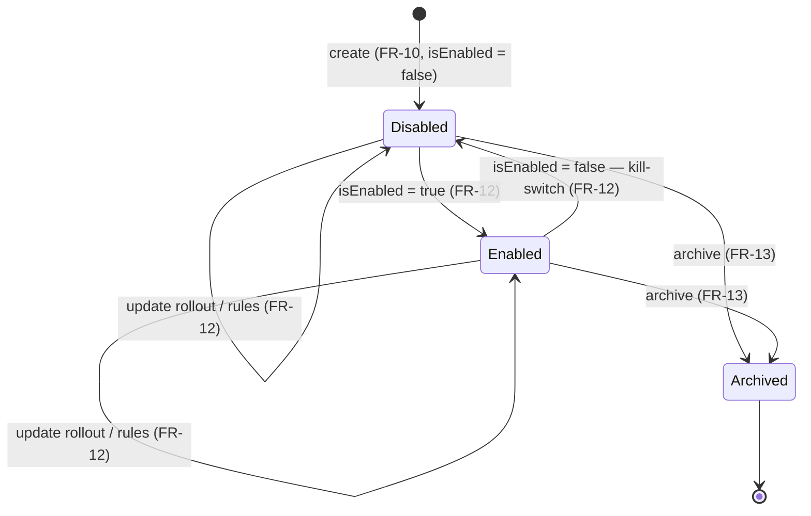
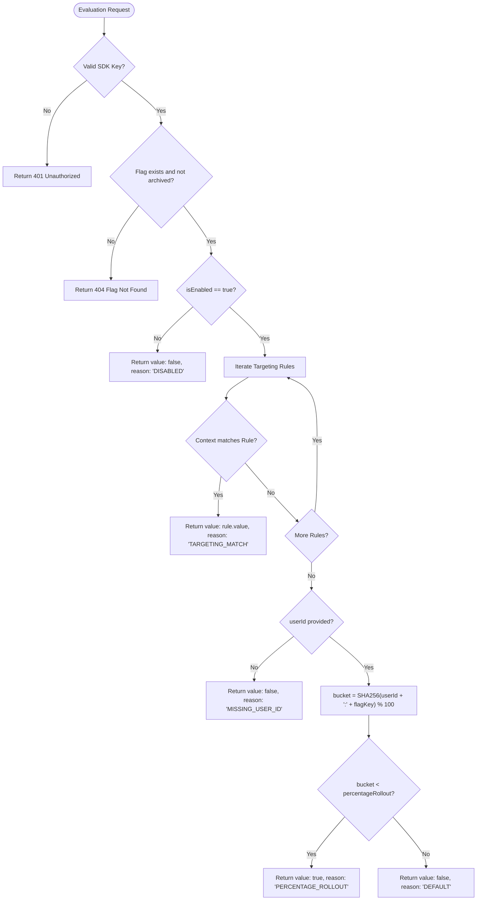
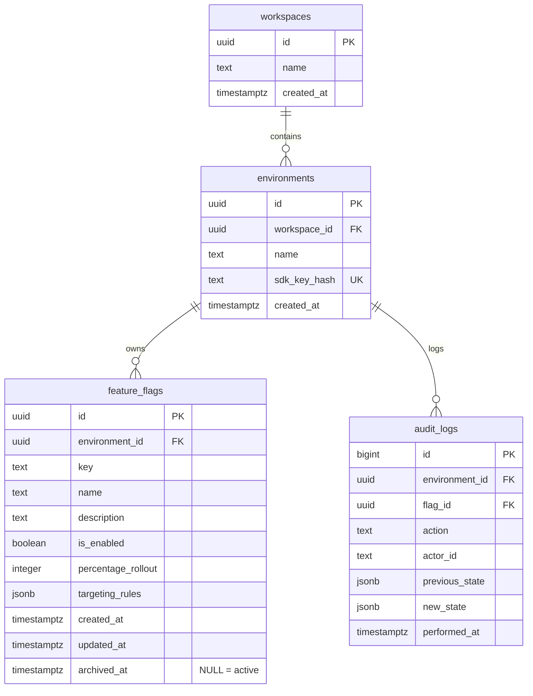

# Software Requirements Specification (SRS)

| | |
| :--- | :--- |
| **Project Name** | FlagForge — Feature Flag & Dynamic Config Engine |
| **Document Version** | 1.2.0 |
| **Status** | Approved |

---

## Table of Contents

1. [Purpose & Scope](#1-purpose--scope)
2. [Glossary](#2-glossary)
3. [Actors](#3-actors)
4. [Functional Requirements (FR-xx)](#4-functional-requirements-fr-xx)
5. [Flag Evaluation Logic & Flow](#5-flag-evaluation-logic--flow)
6. [Data Model (ER-Diagram)](#6-data-model-er-diagram)
7. [Non-Functional Requirements (NFR-xx)](#7-non-functional-requirements-nfr-xx)
8. [Security Requirements (SEC-xx)](#8-security-requirements-sec-xx)
9. [Acceptance Criteria (AC-xx)](#9-acceptance-criteria-ac-xx)
10. [Open Questions & Change Log](#10-open-questions--change-log)

---

## 1. Purpose & Scope

This document specifies the software requirements for **FlagForge**, a B2B SaaS / DevTool feature flag and dynamic configuration management engine. FlagForge enables software engineering teams to decouple code deployments from feature releases through deterministic percentage rollouts, attribute-based targeting rules, and instantaneous kill-switches.

> For the problem context, targeted audience, and scope boundaries, refer to [`docs/00-problem.md`](./00-problem.md).

---

## 2. Glossary

| Term | Definition |
| :--- | :--- |
| **Workspace** | Top-level tenant isolating all environments, feature flags, users, and configuration settings. |
| **Environment** | A deployment stage within a Workspace (e.g., `Development`, `Production`) with its own SDK keys. |
| **Feature Flag** | A decision point in application code that dynamically evaluates to a boolean or variation payload. |
| **Evaluation Context** | JSON payload sent by client applications containing a `userId` and contextual `attributes`. |
| **Targeting Rule** | A conditional rule mapping context attributes to a flag evaluation result (`true` or `false`). |
| **Percentage Rollout** | A deterministic 0–100% allocation strategy using context hashing without mutating state. |
| **SDK Key** | An environment-scoped token used by client applications to authenticate evaluation requests. |
| **Audit Log** | An immutable record tracking configuration modifications, previous states, and actor identities. |

---

## 3. Actors

| # | Actor | Type | Description |
| :--- | :--- | :--- | :--- |
| 1 | **Workspace Admin (Operator)** | Human | Interacts with the FlagForge Dashboard to manage workspaces, flags, environments, and view audit logs. In v1 there is a single bootstrap admin configured via environment variables (no users table); the admin email is used as `actorId` in audit logs. |
| 2 | **Client Application (SDK)** | Machine | Runs in client backend/frontend services and calls the Evaluation API to resolve feature flag states. |
| 3 | **Evaluation Engine** | Internal component | Stateless domain component responsible for executing targeting rules and hashing functions. |

---

## 4. Functional Requirements (FR-xx)

### 4.1 Workspace & Environment Management

| ID | Requirement |
| :--- | :--- |
| **FR-01** | The system shall allow creating and listing Workspaces. |
| **FR-02** | Each Workspace shall contain default Environments (`Development` and `Production`). |
| **FR-03** | The system shall generate a cryptographically secure, unguessable SDK key for each Environment upon creation (prefix: `ff_live_` or `ff_test_`). |
| **FR-04** | The system shall store only the SHA-256 hash of SDK keys. The raw key shall be displayed to the Workspace Admin strictly once upon generation. |
| **FR-05** | The system shall support revoking and re-generating SDK keys for an Environment. |

### 4.2 Feature Flag Management

**FR-10:** The Workspace Admin shall be able to create a Feature Flag specifying:

| Field | Type | Constraints | Default |
| :--- | :--- | :--- | :--- |
| `key` | string | Unique slug per environment, regex `^[a-z0-9-_]{3,64}$` | — |
| `name` | string | Human-readable label, 1–100 characters | — |
| `description` | string | Optional, max 500 characters | — |
| `isEnabled` | boolean | Global master toggle | `false` |
| `percentageRollout` | integer | `0`–`100` | `0` |
| `targetingRules` | array | Array of conditional targeting objects | `[]` |

| ID | Requirement |
| :--- | :--- |
| **FR-11** | The Workspace Admin shall be able to view a paginated list of flags and search by key or name. |
| **FR-12** | The Workspace Admin shall be able to update flag configuration (`isEnabled`, `percentageRollout`, `targetingRules`). |
| **FR-13** | The Workspace Admin shall be able to archive (soft-delete) a feature flag by setting `archivedAt`. Archived flags are excluded from listings and evaluate as `404 Flag Not Found`; their audit history is preserved. |

### 4.3 Evaluation Engine

**FR-20:** The system shall provide a high-performance HTTP endpoint `POST /api/v1/evaluate` accepting an `Evaluation Context`:

```json
{
  "flagKey": "new-checkout-flow",
  "userId": "usr_99211",
  "attributes": {
    "plan": "enterprise",
    "country": "UA"
  }
}
```

**FR-21:** The evaluation engine shall resolve the flag state in strict hierarchical order:

| Step | Condition | `value` | `reason` |
| :--- | :--- | :--- | :--- |
| 1. **Master Switch** | `flag.isEnabled == false` | `false` | `DISABLED` |
| 2. **Targeting Rules** | First rule (in order) that matches the context | `rule.value` | `TARGETING_MATCH` |
| 3. **Percentage Rollout** | `hash(userId + ":" + flagKey) % 100 < percentageRollout` | `true` | `PERCENTAGE_ROLLOUT` |
| 4. **Fallback** | None of the above | `false` | `DEFAULT` |

| ID | Requirement |
| :--- | :--- |
| **FR-22** | If `userId` is missing and a percentage rollout is evaluated, the system shall evaluate rollout to `false` and record `reason: "MISSING_USER_ID"`. |
| **FR-23** | The system shall support the following targeting rule operators: `EQUALS`, `NOT_EQUALS`, `IN`, `CONTAINS`, `GREATER_THAN`. |
| **FR-24** | Evaluation shall be stateless, deterministic, and produce zero database write operations. |

### 4.4 Audit Logging & Security

| ID | Requirement |
| :--- | :--- |
| **FR-30** | The system shall record an immutable Audit Log entry whenever a flag is created, modified, or deleted. |
| **FR-31** | An Audit Log entry shall store: `id`, `environmentId`, `flagId`, `action`, `actorId`, `previousState` (JSON), `newState` (JSON), and `timestamp`. |
| **FR-32** | The system shall authenticate management API requests using signed JWT sessions. |
| **FR-33** | The system shall authenticate Evaluation API requests using Environment SDK Keys passed in the `X-Environment-Key` HTTP header. |

### 4.5 Flag Lifecycle (State Machine)



| State | `isEnabled` | `archivedAt` | Evaluation result |
| :--- | :--- | :--- | :--- |
| **Disabled** | `false` | `NULL` | `value: false`, `reason: "DISABLED"` |
| **Enabled** | `true` | `NULL` | Targeting rules → percentage rollout → default (FR-21) |
| **Archived** | any | set | `404 Flag Not Found` |

- Every transition, including self-transitions, writes an Audit Log entry (FR-30).
- `Archived` is terminal in v1: archived flags cannot be restored or edited, and their `key` stays reserved within the environment.

---

## 5. Flag Evaluation Logic & Flow



---

## 6. Data Model (ER-Diagram)



**Constraints:**

- `feature_flags`: `UNIQUE (environment_id, key)` — a flag key is unique within an environment (FR-10).
- `feature_flags.archived_at`: `NULL` for active flags; set on archive (FR-13). Flags are never hard-deleted, so `audit_logs.flag_id` always references an existing row.
- `audit_logs.actor_id`: email of the Workspace Admin who made the change.

---

## 7. Non-Functional Requirements (NFR-xx)

| ID | Category | Requirement |
| :--- | :--- | :--- |
| **NFR-01** | Performance | Evaluation endpoint `POST /api/v1/evaluate` p95 response time shall be < 15 ms under a load of 500 req/sec on a single-instance Docker deployment. |
| **NFR-02** | Determinism | Identical evaluation context (`userId`, `attributes`) and flag configuration shall yield identical results across all service restarts and nodes. |
| **NFR-03** | Availability | Healthcheck endpoints (`GET /healthz`, `GET /readyz`) shall return system readiness status within 5 ms. |
| **NFR-04** | Statelessness | The Evaluation Engine shall not store client context data or mutation state in memory or database during evaluation. |

---

## 8. Security Requirements (SEC-xx)

| ID | Category | Requirement |
| :--- | :--- | :--- |
| **SEC-01** | SDK Key Hashing | SDK keys shall never be stored in plain text. Storage must use SHA-256 hash representations. |
| **SEC-02** | JWT Authentication | Workspace Admin sessions shall use HTTP-only, `SameSite=Lax` JWT cookies with a 12-hour TTL. |
| **SEC-03** | Input Validation | All incoming HTTP request payloads must be validated against Zod schemas. Invalid payloads must return `400 Bad Request` with structured error details. |
| **SEC-04** | Rate Limiting | The evaluation endpoint shall enforce a rate limit of 1000 requests per minute per SDK Key using a token bucket algorithm. |

---

## 9. Acceptance Criteria (AC-xx)

### AC-01: Deterministic Percentage Rollout

> **Traces to:** FR-21, NFR-02

- **Given** a flag `new-checkout` with `isEnabled = true` and `percentageRollout = 30%`
- **When** the Client API evaluates a context with `userId = "usr_1001"` 100 consecutive times
- **Then** all 100 evaluation responses return an identical value
- **And** the evaluation reason is `"PERCENTAGE_ROLLOUT"`

### AC-02: Targeting Rule Override

> **Traces to:** FR-21, FR-23

- **Given** a flag `beta-dashboard` with `isEnabled = true` and `percentageRollout = 0%`
- **And** a targeting rule: attribute `plan` `EQUALS` `"enterprise"` → `value: true`
- **When** the Client API evaluates the context `{ "userId": "usr_99", "attributes": { "plan": "enterprise" } }`
- **Then** the response returns `value: true` and `reason: "TARGETING_MATCH"`

### AC-03: Disabled Master Switch

> **Traces to:** FR-21, FR-22

- **Given** a flag `dark-mode` with `isEnabled = false`, `percentageRollout = 100%`, and matching targeting rules
- **When** the Client API evaluates a context for any user
- **Then** the response returns `value: false` and `reason: "DISABLED"`

---

## 10. Open Questions & Change Log

### Open Questions

| # | Question | Decision |
| :--- | :--- | :--- |
| 1 | Should we support multivariate variations (e.g., strings/JSON payloads) in v1? | **No.** v1 strictly resolves boolean flags (`true`/`false`) to maintain deterministic performance boundaries. |
| 2 | Should evaluation log impression metrics in the DB? | **Non-goal for v1.** Evaluation is 100% side-effect free. |

### Change Log

| Date | Version | Summary of Changes | Author |
| :--- | :--- | :--- | :--- |
| 2026-10-14 | 1.0.0 | Initial SRS draft for FlagForge core engine | Oleksandr Mushynski |
| 2026-10-14 | 1.1.0 | FR-13: soft delete via `archived_at`; §3: single env-configured admin, `actorId` = admin email; §6: `UNIQUE (environment_id, key)` and `archived_at` column | Oleksandr Mushynski |
| 2026-10-14 | 1.2.0 | §4.5: flag lifecycle state machine (Disabled / Enabled / Archived) | Oleksandr Mushynski |
