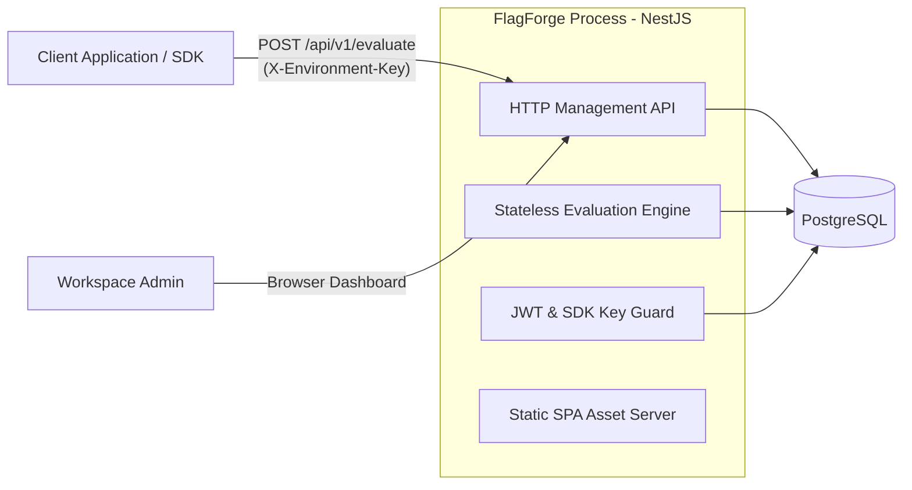
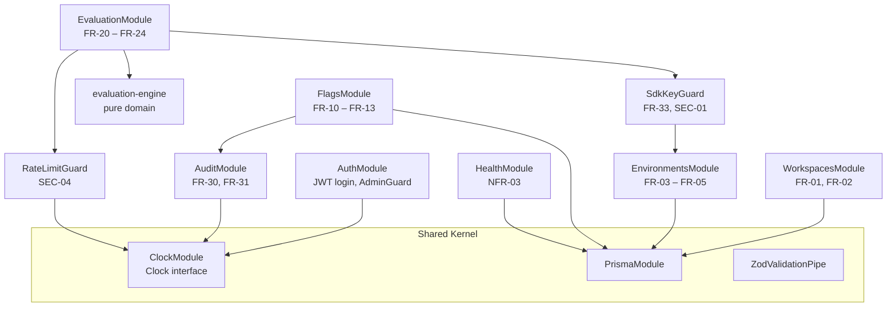
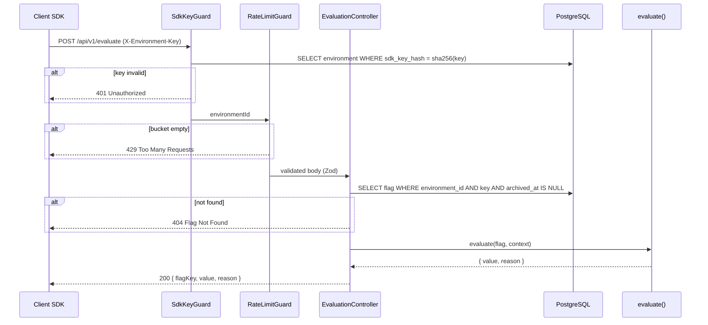
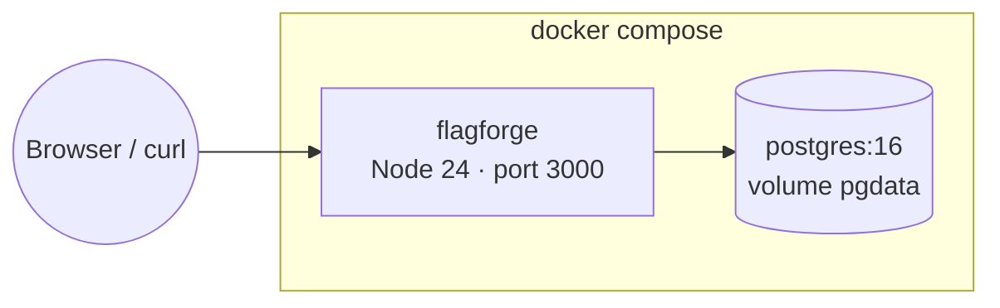

# Architecture & System Design

| | |
| :--- | :--- |
| **Project Name** | FlagForge — Feature Flag & Dynamic Config Engine |
| **Document Version** | 1.1.0 |
| **Status** | Current — describes v1 as built ([change log](#14-change-log)) |
| **Related** | [`00-problem.md`](./00-problem.md) · [`01-srs.md`](./01-srs.md) |

---

## Table of Contents

1. [Overview & Architecture Pattern](#1-overview--architecture-pattern)
2. [Technology Stack](#2-technology-stack)
3. [Module Structure](#3-module-structure)
4. [Repository Layout](#4-repository-layout)
5. [Evaluation Engine Design](#5-evaluation-engine-design)
6. [API Design](#6-api-design)
7. [Data Persistence](#7-data-persistence)
8. [Security Design](#8-security-design)
9. [Frontend (Dashboard)](#9-frontend-dashboard)
10. [Deployment & Configuration](#10-deployment--configuration)
11. [Testing Strategy](#11-testing-strategy)
12. [Architecture Decision Records](#12-architecture-decision-records)
13. [Open Questions (SRS Gaps)](#13-open-questions-srs-gaps)
14. [Change Log](#14-change-log)

---

## 1. Overview & Architecture Pattern

FlagForge is implemented as a **Modular Monolith** using NestJS and PostgreSQL. The system explicitly avoids distributed microservices, message queues (e.g., RabbitMQ, Kafka), or external cache clusters (e.g., Redis) in v1 to adhere to the core constraint: **low operational complexity, single-command deployment, and zero over-engineering**.



**Key principles:**

- **One process, one database.** The whole product ships as a single Docker image plus PostgreSQL (`docker compose up`).
- **Pure domain core.** The evaluation algorithm is a pure function with no I/O, no clock, and no randomness — this is what makes FR-24 and NFR-02 testable.
- **Read-only hot path.** `POST /api/v1/evaluate` performs two indexed point reads (SDK key, flag) and zero writes (FR-24).
- **SRS is the source of truth.** Every module and test traces back to `FR-xx` / `NFR-xx` / `SEC-xx` IDs.

---

## 2. Technology Stack

> This list is exhaustive for v1. Adding any technology not listed here requires explicit approval.

| Layer | Technology | Purpose |
| :--- | :--- | :--- |
| Runtime | Node.js 24 LTS, TypeScript (strict) | Language & runtime |
| Backend framework | NestJS 11 | HTTP, DI, modules, guards |
| Database | PostgreSQL 16 | Persistent storage (JSONB for rules & audit states) |
| ORM / migrations | Prisma 6 (`prisma-client-js`) | Type-safe DB access and SQL migrations. v6 over v7: no driver adapter or extra config needed, CommonJS-native like the NestJS build |
| Validation | Zod | Request/response schemas, shared with the frontend (SEC-03) |
| Auth | `@nestjs/jwt`, `bcrypt`, `cookie-parser` | Admin JWT sessions in HTTP-only cookies (FR-32, SEC-02) |
| Static serving | `@nestjs/serve-static` | Serves the built SPA from the same process; unknown non-API paths fall back to `index.html` |
| Frontend | React 19, Vite, TanStack Query, React Router | Dashboard SPA |
| Testing | Jest, Supertest | Unit, integration, and e2e tests; dashboard logic (rule parsing, audit diff, bucket port) unit-tested with Jest without a DOM |
| Lint / format | ESLint, Prettier | Code quality |
| Packaging | Docker (multi-stage), Docker Compose | Single-command deployment |
| Workspace | pnpm workspaces | Monorepo for `api`, `web`, `shared` |
| API contract | OpenAPI 3.0 (`docs/api/openapi.yaml`) | Hand-written, contract-first API specification |
| CI | GitHub Actions | Lint, typecheck, test, build on every push / PR |
| Contract lint | `@redocly/cli` (dev only) | Validates `docs/api/openapi.yaml` locally and in CI |

**Explicitly excluded in v1:** Redis, message brokers, Kubernetes manifests, GraphQL, edge/CDN workers, external auth providers.

---

## 3. Module Structure

Each NestJS module owns its controllers, services, and repositories. Cross-module access goes only through exported services — never through another module's repository.



| Module | Responsibility | Requirements |
| :--- | :--- | :--- |
| `ClockModule` | Provides `Clock { now(): Date }`. Domain code never calls `Date.now()` / `new Date()` directly. | — |
| `AuthModule` | Admin login/logout, JWT issuance, `AdminGuard` for management routes. | FR-32, SEC-02 |
| `WorkspacesModule` | Create/list workspaces; creates default `Development` + `Production` environments in one transaction. | FR-01, FR-02 |
| `EnvironmentsModule` | SDK key generation, hashing, rotation, lookup by hash. | FR-03 – FR-05, SEC-01 |
| `FlagsModule` | Flag CRUD, pagination, search. Every mutation writes an audit entry in the same transaction. | FR-10 – FR-13 |
| `AuditModule` | Append-only audit log writes and paginated reads. | FR-30, FR-31 |
| `EvaluationModule` | `POST /api/v1/evaluate` controller; loads flag, delegates to the pure engine. | FR-20 – FR-24, NFR-01 |
| `HealthModule` | `GET /healthz` (liveness) and `GET /readyz` (DB ping). | NFR-03 |

---

## 4. Repository Layout

```text
flagforge/
├─ README.md                    # Product overview, quick start, demo guide, links to docs
├─ CLAUDE.md                    # Instructions for the AI agent
├─ PLAN.md                      # Phased execution plan
├─ docs/
│  ├─ 00-problem.md             # Problem definition
│  ├─ 01-srs.md                 # SRS with FR-xx, NFR-xx, SEC-xx & change log
│  ├─ 02-design.md              # This document
│  ├─ adr/                      # Decision records (0001-modular-monolith.md, ...)
│  ├─ api/openapi.yaml          # OpenAPI 3.0 specification (contract)
│  ├─ 03-validation.md          # Traceability matrix, implemented vs changed, technical debt
│  ├─ 04-ai-usage.md            # AI usage log (prompts, value, mistakes corrected)
│  └─ 05-retrospective.md       # Retrospective and future roadmap
├─ apps/
│  ├─ api/                      # NestJS: Management API + Evaluation API + static SPA server
│  │  ├─ src/
│  │  │  ├─ common/             # Clock, Zod pipe, error filter
│  │  │  ├─ auth/
│  │  │  ├─ workspaces/
│  │  │  ├─ environments/
│  │  │  ├─ flags/
│  │  │  ├─ audit/
│  │  │  ├─ evaluation/
│  │  │  │  └─ engine/          # pure domain: evaluate(), bucket(), operators
│  │  │  ├─ health/
│  │  │  └─ main.ts
│  │  ├─ prisma/                # schema.prisma, migrations/
│  │  └─ test/                  # e2e tests (Supertest)
│  └─ web/                      # React + Vite dashboard (built & served by NestJS in prod)
├─ packages/
│  └─ shared/                   # Zod schemas, evaluation types & DTOs shared by api and web
├─ scripts/demo.sh              # Automated evaluation & rollout verification
├─ docker-compose.yml           # Local dev & prod stack (PostgreSQL + FlagForge app)
├─ Dockerfile                   # Multi-stage single image build
├─ .github/workflows/ci.yml     # CI pipeline (lint, typecheck, test, build)
├─ .env.example
└─ pnpm-workspace.yaml
```

---

## 5. Evaluation Engine Design

### 5.1 Pure function contract

```ts
// apps/api/src/evaluation/engine/evaluate.ts
export type Reason =
  | 'DISABLED'
  | 'TARGETING_MATCH'
  | 'PERCENTAGE_ROLLOUT'
  | 'MISSING_USER_ID'
  | 'DEFAULT';

export interface EvaluationResult {
  value: boolean;
  reason: Reason;
}

export function evaluate(flag: FlagSnapshot, context: EvaluationContext): EvaluationResult;
```

The function receives an immutable snapshot of the flag and the request context. It performs no I/O and has no hidden inputs, so identical inputs always produce identical outputs (NFR-02).

### 5.2 Resolution order (FR-21, FR-22)

1. `flag.isEnabled === false` → `{ value: false, reason: 'DISABLED' }`
2. For each rule in array order: if it matches → `{ value: rule.value, reason: 'TARGETING_MATCH' }`
3. `userId` missing or empty → `{ value: false, reason: 'MISSING_USER_ID' }`
4. `bucket(userId, flagKey) < percentageRollout` → `{ value: true, reason: 'PERCENTAGE_ROLLOUT' }`
5. Otherwise → `{ value: false, reason: 'DEFAULT' }`

### 5.3 Deterministic bucketing

```ts
import { createHash } from 'node:crypto';

export function bucket(userId: string, flagKey: string): number {
  const digest = createHash('sha256').update(`${userId}:${flagKey}`, 'utf8').digest();
  return digest.readUInt32BE(0) % 100; // 0..99
}
```

- Uses the **first 4 bytes** of the SHA-256 digest as an unsigned big-endian integer.
- Including `flagKey` in the input decorrelates buckets across flags (a user in the first 10% of one flag is not automatically in the first 10% of every flag).
- The modulo bias of `2^32 % 100` is ~2.3·10⁻⁸ and acceptable.
- The algorithm is frozen for v1: changing it would reshuffle every user's bucket and is a breaking change.

### 5.4 Targeting rule schema & operators (FR-23)

```ts
type TargetingRule = {
  attribute: string;                     // key inside context.attributes
  operator: 'EQUALS' | 'NOT_EQUALS' | 'IN' | 'CONTAINS' | 'GREATER_THAN';
  values: (string | number | boolean)[]; // single-element for scalar operators
  value: boolean;                        // result when the rule matches
};
```

| Operator | Matches when | Notes |
| :--- | :--- | :--- |
| `EQUALS` | `attr === values[0]` | Strict equality, no type coercion. |
| `NOT_EQUALS` | attribute present and `attr !== values[0]` | Missing attribute never matches. |
| `IN` | `values.includes(attr)` | — |
| `CONTAINS` | `typeof attr === 'string' && attr.includes(String(values[0]))` | Case-sensitive substring. |
| `GREATER_THAN` | `typeof attr === 'number' && attr > Number(values[0])` | Non-numeric attribute never matches. |

A rule referencing an attribute that is absent from the context **does not match** and evaluation continues with the next rule.

### 5.5 Request flow



### 5.6 Performance (NFR-01)

- Two indexed point lookups per request (`environments.sdk_key_hash` UNIQUE, `feature_flags(environment_id, key)` UNIQUE).
- Prisma connection pool sized via `DATABASE_POOL_SIZE` (default 10).
- **No in-process flag cache in v1.** A cache would add invalidation complexity and is not needed to reach p95 < 15 ms on a single instance. If load tests show otherwise, an in-memory cache invalidated on flag writes is the first option and will be proposed as an SRS/design change.

---

## 6. API Design

All routes are prefixed with `/api/v1`. Request bodies are validated with Zod; errors use a single format.

### 6.1 Management API (JWT cookie, `AdminGuard`)

| Method | Path | Description | Req |
| :--- | :--- | :--- | :--- |
| `POST` | `/auth/login` | Exchange admin credentials for a session cookie | FR-32 |
| `POST` | `/auth/logout` | Clear session cookie | FR-32 |
| `GET` | `/workspaces` | List workspaces | FR-01 |
| `POST` | `/workspaces` | Create workspace + default environments | FR-01, FR-02 |
| `GET` | `/workspaces/:workspaceId/environments` | List environments | FR-02 |
| `POST` | `/environments/:environmentId/sdk-key/rotate` | Revoke & regenerate SDK key; returns raw key once | FR-03 – FR-05 |
| `GET` | `/environments/:environmentId/flags?page=&pageSize=&q=` | Paginated flag list, search by key/name | FR-11 |
| `POST` | `/environments/:environmentId/flags` | Create flag | FR-10 |
| `GET` | `/flags/:flagId` | Get flag | FR-11 |
| `PATCH` | `/flags/:flagId` | Update `isEnabled`, `percentageRollout`, `targetingRules` | FR-12 |
| `DELETE` | `/flags/:flagId` | Archive flag (soft delete, sets `archived_at`) | FR-13 |
| `GET` | `/environments/:environmentId/audit-logs?page=&pageSize=&flagId=` | Paginated audit log | FR-30, FR-31 |

### 6.2 Evaluation API (`X-Environment-Key`)

```http
POST /api/v1/evaluate
X-Environment-Key: ff_live_...
Content-Type: application/json

{ "flagKey": "new-checkout-flow", "userId": "usr_99211", "attributes": { "plan": "enterprise" } }
```

```json
{ "flagKey": "new-checkout-flow", "value": true, "reason": "TARGETING_MATCH" }
```

### 6.3 Health (unauthenticated, no prefix)

| Method | Path | Behavior |
| :--- | :--- | :--- |
| `GET` | `/healthz` | Returns `200 { "status": "ok" }` without touching the DB. |
| `GET` | `/readyz` | Runs `SELECT 1`; `200` if DB reachable, `503` otherwise. |

### 6.4 Error format

```json
{
  "statusCode": 400,
  "error": "Bad Request",
  "message": "Validation failed",
  "details": [{ "path": ["percentageRollout"], "message": "Too big: expected number to be <=100" }]
}
```

| Status | When |
| :--- | :--- |
| `400` | Malformed JSON body or Zod validation failure (SEC-03) |
| `401` | Missing/invalid JWT or SDK key |
| `404` | Resource or flag not found |
| `409` | Duplicate flag key within an environment |
| `413` | Request body larger than 100 kB |
| `429` | Rate limit exceeded (SEC-04) |

---

## 7. Data Persistence

The logical model is defined in [SRS §6](./01-srs.md#6-data-model-er-diagram). Physical details added by this design:

| Table | Constraint / Index | Purpose |
| :--- | :--- | :--- |
| `environments` | `UNIQUE (sdk_key_hash)` | O(1) SDK key lookup (FR-33) |
| `environments` | `UNIQUE (workspace_id, name)` | One `Development` / `Production` per workspace |
| `feature_flags` | `UNIQUE (environment_id, key)` | Flag key uniqueness per environment (FR-10) |
| `feature_flags` | `CHECK (percentage_rollout BETWEEN 0 AND 100)` | Defense in depth for FR-10 |
| `feature_flags` | Evaluation and listings filter `archived_at IS NULL` | Archived flags behave as not found (FR-13) |
| `audit_logs` | `INDEX (environment_id, performed_at DESC)` | Paginated audit view |
| `audit_logs` | `BEFORE UPDATE OR DELETE` row trigger + `BEFORE TRUNCATE` statement trigger | Enforces immutability at DB level (FR-30); `TRUNCATE` bypasses row triggers |
| `audit_logs` | `CHECK (action IN ('CREATED', 'UPDATED', 'ARCHIVED'))` | Actions match the flag lifecycle (SRS §4.5) |
| `feature_flags` | `CHECK (key ~ '^[a-z0-9_-]{3,64}$')` | Defense in depth for FR-10 |

**Transactions:** every flag mutation and its audit entry are written in one Prisma interactive transaction. Updates and archives first take a row lock (`SELECT … FOR UPDATE`) so concurrent changes serialize and each audit entry records the true previous state. `previousState` / `newState` are full flag snapshots (JSONB); `performed_at` is set from the injected `Clock`.

**Migrations:** Prisma migrations are committed to the repo and applied automatically on container start (`prisma migrate deploy`).

---

## 8. Security Design

| Concern | Design | Req |
| :--- | :--- | :--- |
| SDK key generation | `ff_live_` (Production) / `ff_test_` (Development) + 32 bytes from `crypto.randomBytes`, base64url-encoded. | FR-03 |
| SDK key storage | Only `sha256(rawKey)` hex is stored. Raw key returned once in the create/rotate response and never logged. | FR-04, SEC-01 |
| SDK key rotation | Rotation replaces the hash atomically; the old key stops working immediately. | FR-05 |
| Admin authentication | Single bootstrap admin from env (`ADMIN_EMAIL`, `ADMIN_PASSWORD_HASH` — bcrypt), validated at startup. A wrong email is checked against a dummy hash so both failure paths take the same time and return the same message. | FR-32 |
| Route protection | Global `AdminGuard`, deny by default; only `/healthz`, `/readyz`, `/auth/*` and `/evaluate` (SDK key) are `@Public()`. | FR-32 |
| Session | HS256 JWT (`JWT_SECRET`), cookie `ff_session`: `HttpOnly`, `SameSite=Lax`, `Secure` in production, 12 h TTL. `iat`/`exp` are set from the injected `Clock` and verified against it. | SEC-02 |
| Input validation | Global `ZodValidationPipe`; schemas live in `packages/shared`. | SEC-03 |
| Rate limiting | In-memory token bucket per environment: capacity `RATE_LIMIT_PER_MINUTE` (default 1000), refill `RATE_LIMIT_PER_MINUTE / 60` tokens per second, time from `Clock`. Valid because v1 is single-instance. | SEC-04 |
| Logging | No request logging in v1. The error filter logs only stack traces of unexpected 5xx errors, never headers or bodies, so SDK keys, cookies and passwords cannot reach the logs. | SEC-01 |
| Response headers | `X-Powered-By` removed; `X-Content-Type-Options: nosniff`, `Referrer-Policy: no-referrer` and a `Content-Security-Policy` (`'self'` plus Google Fonts, `frame-ancestors 'none'`) on every response. | — |

---

## 9. Frontend (Dashboard)

A minimal React SPA built with Vite and served by NestJS from the same origin (no CORS configuration needed).

| Screen | Features |
| :--- | :--- |
| Login | Email + password form |
| Workspaces | List / create workspaces, switch environment |
| Flags | Paginated table with search, master toggle inline (kill-switch) |
| Flag editor | Name, description, rollout slider (0–100), targeting rule builder |
| Playground | Send an evaluation context and see `value` + `reason` |
| SDK keys | Rotate key, show raw key once with a copy button |
| Audit log | Paginated list with diff of `previousState` → `newState` |

Server state is managed with TanStack Query. Forms check input before sending (the flag key pattern from `packages/shared`, typed rule values); the API's Zod schemas stay the authority (SEC-03) and their error messages are shown in the form.

- **Rollout visualization:** the rollout is drawn as the 100 deterministic buckets (10×10). The playground highlights the bucket of the evaluated user, using a Web Crypto port of `bucket()` pinned to the server's golden vectors. The server stays the source of truth for the result.
- **Playground and SDK keys:** since only key hashes are stored (FR-04), the playground asks for the environment's raw key and keeps it in `sessionStorage` for that tab only.
- **Production safety:** the Production environment is marked with a red rule across the workspace and red labels; archive and key rotation require an inline confirmation.

---

## 10. Deployment & Configuration



- **Dockerfile:** multi-stage on `node:24-bookworm-slim` (Debian rather than Alpine: Prisma engines and the native `bcrypt` module work without musl workarounds) — build `shared`, `web`, `api`; final image contains only the compiled API, the built SPA, the migrations and production dependencies, and runs as the unprivileged `node` user with a `/readyz` healthcheck.
- **Demo defaults:** `docker-compose.yml` ships demo credentials so `docker compose up` works with no setup; every value can be overridden from `.env`, and the README tells operators to replace them.
- **Startup:** `prisma migrate deploy` → start NestJS. Compose uses a Postgres healthcheck so the app waits for the DB.
- **Database port:** Compose publishes PostgreSQL only on `127.0.0.1`, on host port `55432` by default (`POSTGRES_PORT`), so it neither collides with a local PostgreSQL on `5432` nor is reachable from the network with the demo password.

| Variable | Required | Default | Description |
| :--- | :--- | :--- | :--- |
| `DATABASE_URL` | yes | — | PostgreSQL connection string |
| `DATABASE_POOL_SIZE` | no | `10` | Prisma connection pool size |
| `JWT_SECRET` | yes | — | HS256 signing secret (≥ 32 chars) |
| `ADMIN_EMAIL` | yes | — | Bootstrap admin login |
| `ADMIN_PASSWORD_HASH` | yes | — | bcrypt hash of the admin password |
| `PORT` | no | `3000` | HTTP port |
| `RATE_LIMIT_PER_MINUTE` | no | `1000` | Evaluation requests per minute per SDK key (SEC-04) |
| `COOKIE_SECURE` | no | `true` if `NODE_ENV=production` | `Secure` flag of the session cookie; `false` only for plain-HTTP deployments |
| `WEB_DIST_PATH` | no | `apps/web/dist` | Location of the built dashboard (ADR-0007) |
| `NODE_ENV` | no | `production` | Enables `Secure` cookies in production |

---

## 11. Testing Strategy

Test names reference requirement IDs, e.g. `it('FR-21: returns DISABLED when master switch is off')`.

| Level | Scope | Tools | Examples |
| :--- | :--- | :--- | :--- |
| Unit | Pure engine, operators, bucketing, token bucket, SDK key hashing | Jest | Golden-vector test for `bucket()`; distribution test (10k users ≈ configured %) |
| Integration | Services + real PostgreSQL | Jest, Prisma, Compose Postgres | Flag update writes audit entry in same transaction; audit row cannot be updated |
| E2E | HTTP API end to end | Jest, Supertest | AC-01, AC-02, AC-03 from SRS §9; 401 / 404 / 429 paths |
| Performance | NFR-01 load test | `scripts/load-test.mjs` (open-loop, 500 req/s across 40 SDK keys); `scripts/demo.sh` reports single-client round-trip latency | p95 < 15 ms at 500 req/s on a single instance |

Time-dependent logic (JWT expiry, rate limiting, audit timestamps) is tested with a fake `Clock`.

---

## 12. Architecture Decision Records

Summary below; each decision has a full record (context, options, consequences) in [`docs/adr/`](./adr/).

| ADR | Decision | Alternatives considered | Rationale |
| :--- | :--- | :--- | :--- |
| ADR-01 | Modular monolith | Microservices | Single-command deployment, low operational complexity. |
| ADR-02 | PostgreSQL + JSONB for targeting rules | Normalized rules table | Rules are always read/written as a whole with the flag; JSONB keeps it one row. |
| ADR-03 | No cache layer in v1 | Redis, in-process LRU | Indexed reads meet NFR-01; kill-switch takes effect instantly without invalidation logic. |
| ADR-04 | SHA-256 for bucketing | MurmurHash, FNV | Built into Node (`node:crypto`), no dependency, well-distributed, matches SRS §5. |
| ADR-05 | In-memory rate limiter | Redis-backed limiter | v1 is single-instance by design; no extra infrastructure. |
| ADR-06 | Env-configured single admin | Users table, OAuth | Multi-user RBAC is a v1 non-goal; avoids a user model absent from the SRS. |
| ADR-07 | SPA served by NestJS | Separate web container / CDN | One image, same origin, no CORS. |

---

## 13. Open Questions (SRS Gaps)

All gaps found while writing this design were resolved in SRS v1.1.0:

| # | Topic | Resolution | SRS |
| :--- | :--- | :--- | :--- |
| 1 | Flag deletion vs. immutable audit FK | Soft delete via `feature_flags.archived_at`; archived flags evaluate as `404`. | FR-13, §6 |
| 2 | Admin identity | Single env-configured admin (ADR-06); `actor_id` = admin email. | §3, §6 |
| 3 | Flag key uniqueness | `UNIQUE (environment_id, key)`. | §6 |
| 4 | `MISSING_USER_ID` with 0% rollout | Kept as in the SRS flowchart: `userId` is checked before rollout regardless of percentage. | §5 |

---

## 14. Change Log

| Date | Version | Summary of Changes | Author |
| :--- | :--- | :--- | :--- |
| 2026-10-14 | 1.0.0 | Initial design: architecture, stack, modules, evaluation engine, API, persistence, security, dashboard, deployment, testing, ADR summary | Oleksandr Mushynski |
| 2026-10-14 | 1.0.0 | Repository layout and stack aligned with the project structure (pnpm workspaces, OpenAPI contract, CI, `@redocly/cli`) | Oleksandr Mushynski |
| 2026-10-14 | 1.0.0 | Phase 3: Prisma 6 chosen over 7; `BEFORE TRUNCATE` trigger and CHECK constraints added to §7 | Oleksandr Mushynski |
| 2026-10-14 | 1.0.0 | SRS v1.3.0: rate limit configurable via `RATE_LIMIT_PER_MINUTE` (§8, §10) | Oleksandr Mushynski |
| 2026-10-14 | 1.0.0 | Phase 6: row lock for concurrent updates (§7); startup-validated admin, deny-by-default guard, `Clock`-based JWT times (§8) | Oleksandr Mushynski |
| 2026-10-14 | 1.0.0 | Phase 7: SPA fallback, dashboard logic tests, bucket grid, playground SDK key, Production safety (§2, §9) | Oleksandr Mushynski |
| 2026-10-14 | 1.0.0 | Phase 8: Docker image, demo defaults, `COOKIE_SECURE`, `WEB_DIST_PATH` (§10) | Oleksandr Mushynski |
| 2026-10-14 | 1.1.0 | Repository review: versioning and this change log introduced (earlier rows were edits made under 1.0.0); §1 two reads per evaluation; §6.4 `400` for malformed JSON, `413`; §8 actual logging behavior and response headers; §9 how forms validate; §10 database port; §11 load-test tool | Oleksandr Mushynski |
